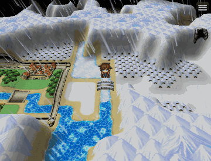
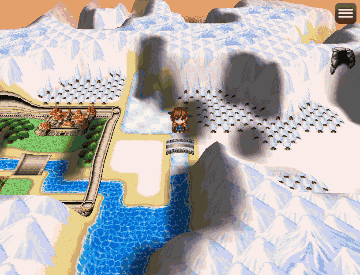
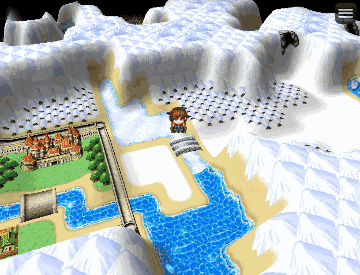

# Doc's Doodads

A visual asset workspace and doodad engine for RPG Maker MZ. It began as an upgrade of Qiu Jiu's MIT-licensed QJ-Doodads plugin and has grown into its own tool. It adds a friendly, game-like editor with a searchable Item Bag, sprite-sheet detection and slicing, modern map-editing tools, real MZ event authoring, transactional asset import, and protected project saves.

Placed doodads sort in front of or behind the player by their base line and can sway, flicker, cast shadows, and give off light under a map's ambient darkness. The editor adds a path tool, prefabs, a rule-based scatter brush, drag-to-move with smart guides, cross-map copy/move, neighbouring-map edge mirroring, and a World View. A world layer adds a day/night clock with lamps that switch on after dark, sun shadows for characters and doodads, see-through trees and roofs, water reflections, motion blur, seasons, and animated appear/disappear effects. Post-processing adds bloom, colour grading, CRT, lens, grain, vignette, tilt-shift and more, with presets, per-map looks, animated screen effects and full-map image export. Particle emitters, reactive grass, an Effects Maker and character animation (idle/run cycles, any number of frames, single-row and 8-direction sheets, one-command actions) bring maps and characters to life. Spatial sound places event sounds in the world (distance, pan, variation), adds ambient emitters, cave echo, background sounds by region, ambience layers and footsteps by ground, and players can zoom in on their character to bring nearby sounds forward. Traversal adds jumping, gliding, swimming, diving, flying, climbing and ice. Editor tools add layers, symmetry, a biome brush, map dressing rules, a visual save history, animated thumbnails and a Ctrl+K command palette. Visual equipment draws gear on characters, followers, events and side-view battlers (with hide tags, colours, body-type aliases, layers straight from Aseprite files and an equip-screen preview), and the click-to-walk destination marker can be restyled or animated, with dots along the path. A 3D view lays any map on a perspective ground plane, or wraps it onto a small planet or rolling log, with raised terrain (automatic mountains, regions, terrain tags or a height brush), interior walls, standing billboards, animated glTF models, a turnable camera, weather, day and night, rippling water, fog, a parallax or video sky and a see-through silhouette, and the editor keeps working in it. For managing assets it adds collections, where-used, safe rename/move, duplicate and look-alike finding, live reload, and per-map art packing for deployed games.

### The 3D view

| Weather | Day and night | Camera |
| :---: | :---: | :---: |
|  |  |  |

New to it? [Your First 3D Map](docs/FIRST_3D_MAP.md) walks from a flat map to hills, water, weather and day and night.

## Install

Doc's Doodads is for RPG Maker MZ only.

1. Copy `Docs-Doodads.js` to your RPG Maker project's `js/plugins/` directory.
2. Enable **Docs-Doodads** in Plugin Manager.
3. Start a playtest and press **F10** to open the editor. A welcome card shows the first steps, and a hint bubble says what to do next.

The editor only runs in a playtest. In a deployed game the doodads, lights, sounds and 3D view work, but the editor and its file writing are off. If doodads don't show in a deployed game, leave **Exclude unused files** off in File > Deployment (it leaves out `img/doodads`); missing art is skipped with a console warning instead of stopping the game.

Coming from QJ-Doodads? Replace `QJ-Doodads.js` with `Docs-Doodads.js` in Plugin Manager. Existing doodads, the asset library, templates, layouts, backups, and plugin settings are picked up automatically and saved under the new names on your next save.

See [Docs_Doodads_Guide.md](Docs_Doodads_Guide.md) for usage, [CHEAT_SHEET.md](CHEAT_SHEET.md) for every notetag and plugin command on one page, [CHANGELOG.md](CHANGELOG.md) for what changed, and [RECOMMENDATIONS.md](RECOMMENDATIONS.md) for what is planned. The original implementation plan is kept in [docs/archive](docs/archive/Docs_Doodads_Implementation_Plan.md) for history.

## The editor at a glance

- **Top bar**: big tools with their names (Select, Stamp, Scatter, Paint, Path, Hills, Mirror, Grab); a tool's options open in a card under its button. Then Undo, Redo, Steps (the undo history), More, Save and Done.
- **More**: Cut Up Sheet, Screen Looks, Effects Maker, Old Saves, File Check, Info, Show Grid, Show Collision, Sounds, Find a Tool (Ctrl+K), Messages, Look (size, theme, map colours), Rooms, Packs, Characters (the character creators), Keys, Capture, Problems, Show Sounds, Listen, Show Speed and How to Use, then the layouts.
- **Item Bag** (left): search, collections and category tabs. **Details** (right): the settings of whatever is picked. Both fold away to small tabs.

## Building from source

The plugin ships as one file, `Docs-Doodads.js`, built from the parts in `src/`:

```powershell
npm run build     # join src/ into Docs-Doodads.js
npm run icons     # redraw the editor's pixel icons (art/ui_icons.png) into src/36_ui_icons.js
npm run fonts     # embed the editor's font (art/fonts) into src/36_ui_fonts.js
npm run deploy -- <project folder> <output folder> [--key <text>] [--no-encrypt] [--devtools]
```

`npm run deploy` makes a Windows build the way MZ's File > Deployment makes one with image and audio encryption on, for testing the plugin in a real deployed game without opening the editor. See [CONTRIBUTING.md](CONTRIBUTING.md) for how the source is laid out.

## Verification

Install the pinned development dependencies, then run the complete preflight and coverage gate:

```powershell
npm install
npm run verify
npm run coverage
```

The regression tests themselves use only Node.js. Drawing code (spritesets, character sprites, the 3D view, the editor overlay) runs on a small stand-in for PIXI and the MZ classes in `scratch/engine/fake_engine.js`. The coverage command uses `c8` and enforces 85% of lines and statements, 80% of functions and 75% of branches (about 89% of lines are covered); the editor's HTML panels remain covered by the manual checklist. Each suite runs in a folder of its own in the system's temp folder, and `npm run verify` fails if a suite changed the repository. It also lints the built plugin, the scripts and the suites with ESLint (`npm run lint`), checks that the translation template and the guide's shortcut table are current, and that package.json, the plugin header, `pluginVersion` and the changelog name the same version.

Use [MANUAL_TEST_CHECKLIST.md](MANUAL_TEST_CHECKLIST.md) for the final RPG Maker MZ playtest.

`QJ-Doodads.original.js` is Qiu Jiu's original V1.2 plugin, retained as the upstream baseline for compatibility comparison.
