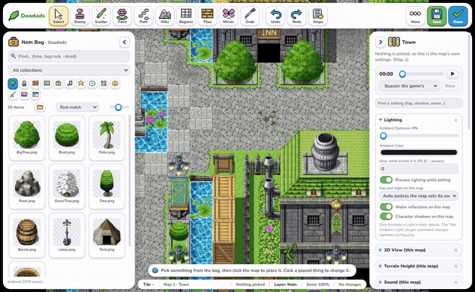
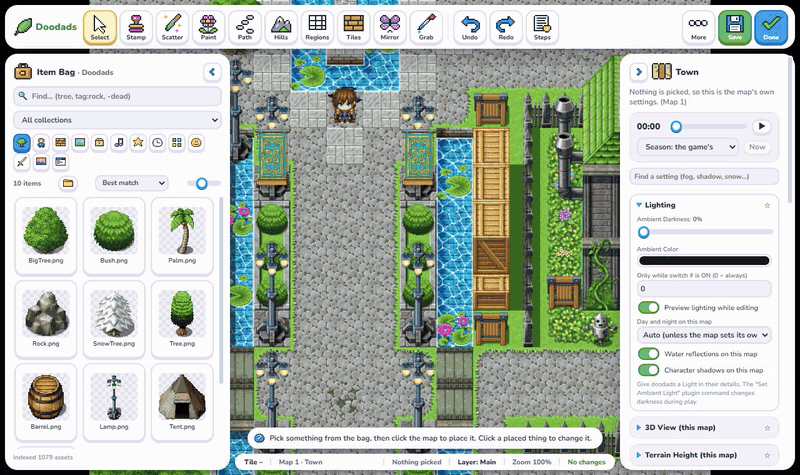
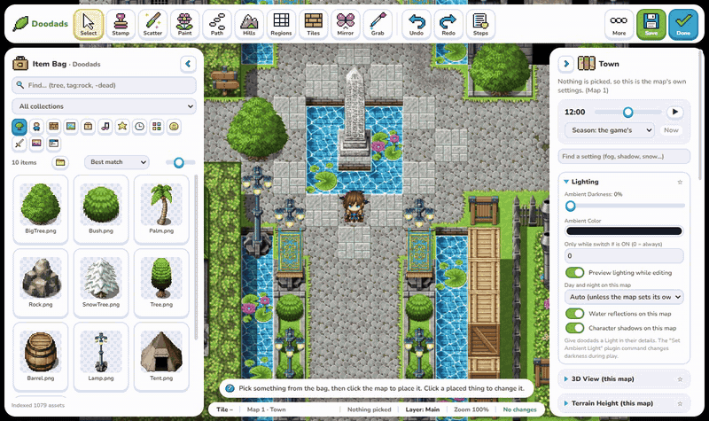
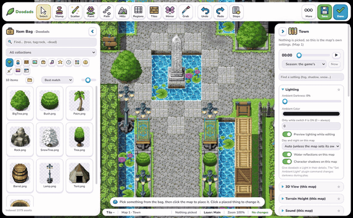
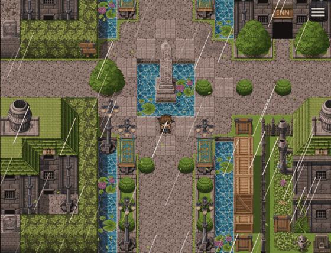
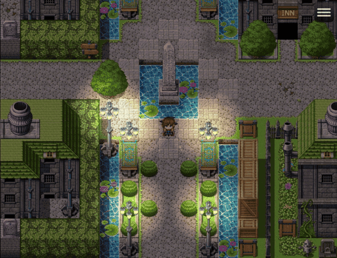
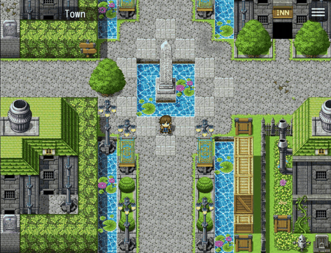
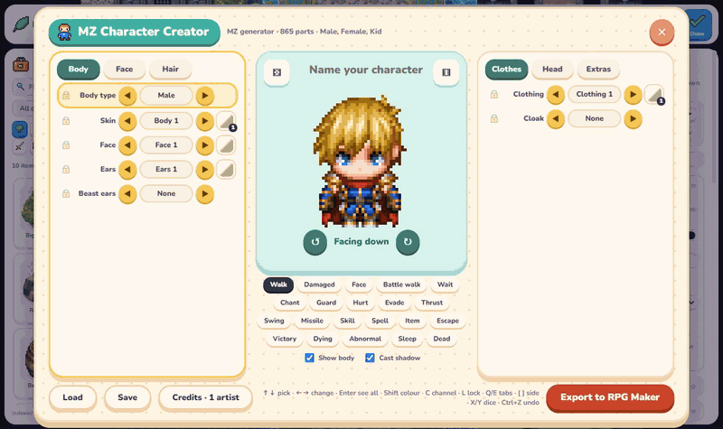

# Doc's Doodads

A map editor and doodad engine for RPG Maker MZ that runs inside your playtest. Press **F10** and you can:
- place art anywhere on the map, off the grid, from a searchable Item Bag;
- light the map, turn day into night, add weather, particles and screen effects;
- make real MZ events;
- walk, jump and fly around what you built;
- see the same map in 3D.

It began as an upgrade of Qiu Jiu's MIT-licensed QJ-Doodads and has grown into its own tool.



## See it work

| A lasso, then Find picks every bush | Day to night with the editor's clock |
| :---: | :---: |
|  |  |
| **Screen Looks** | **A storm: rain, wind, lightning** |
|  |  |
| **Lamps, fireflies and a magic burst at dusk** | **Flying (Traversal)** |
|  |  |

### The character creators



Characters from RPG Maker MZ's own generator parts, the LPC library or the Memao pack, in one window, exported straight to your project.

### The 3D view

| Weather | Day and night | Camera |
| :---: | :---: | :---: |
|  |  |  |

New to it? [Your First 3D Map](docs/FIRST_3D_MAP.md) walks from a flat map to hills, water, weather and day and night.

The clips were recorded in RPG Maker MZ 1.10, on MZ's sample maps and with MZ's own art. That art is not part of this plugin.

## Everything it can do

Each heading links to its part of the [user guide](Docs_Doodads_Guide.md). [CHEAT_SHEET.md](CHEAT_SHEET.md) has every notetag and plugin command on one page.

### [The editor](Docs_Doodads_Guide.md#4-the-item-bag--search)
- **Opening it:** F10 in a playtest opens it over the running map; Done closes it. It never runs in a deployed game.
- **Item Bag:** every picture, sound and prefab in the project.
  - **Search:** words, `tag:`, `type:`, `folder:`, `category:`, `favorite:`, `used:`, and `-` to leave a word out. Each term shows as a chip, and searches can be saved.
  - **Organizing:** tabs by kind, collections, favourites, recently used, a folder view and six sort orders.
  - **Looking:** thumbnail sizes, animated thumbnails, and a hover card with the item's size, frames, depth and uses.
- **Picking several items in the bag:** Ctrl+click and Shift+click, then tag them, favourite them, add them to a collection, move them to another folder, or delete the unused ones.
- **Tools on the top bar:**
  - **Select;**
  - **Stamp;**
  - **Scatter:** spacing, region and terrain-tag rules, skipping tiles you can't walk on; right-drag erases;
  - **Paint:** biome mixes;
  - **Path:** fences with end and corner pieces;
  - **Hills:** terrain height;
  - **Regions:** paints region numbers;
  - **Tiles:** paints MZ's own A1–E tiles, autotiles included;
  - **Mirror:** symmetry, two or four ways;
  - **Grab:** the eyedropper.
- **Moving and arranging:**
  - drag with smart guides and a readout of position, tile and size;
  - handles to resize and turn;
  - arrow keys to nudge; Ctrl+arrows move by a tile where the ground allows;
  - snap to the grid; line up, space out evenly, or space by so many pixels;
  - group, lock, hide, and bring forward or back.
- **Picking on the map:**
  - click, or Shift+click to add;
  - a box (Ctrl+drag picks what the box touches), or Alt+drag for a lasso;
  - everything in a region;
  - Select All, Select Same Art, everything on a layer, Invert.
- **Find:** searches this map or every map by picture, name, tag, layer, `has:light`, `has:sound`, `is:locked` and more. Pick All, Hide, Show, Lock and Unlock act on all results at once.
- **Outliner:** lists the map's doodads by layer, with Hide, Lock and Solo.
- **Copying:** copy and paste, Paste in Place (on another map too), Copy to Map, Move to Map, and Replace Art on one map or every map.
- **Reusing:**
  - **Prefabs:** they can hold other prefabs, each copy can keep its own settings, and copies are synced from the master;
  - **Room stamps:** tiles, doodads, regions and events together;
  - **Packs:** one `.ddpack` file to carry art, prefabs, rooms, biomes, dressing rules, collections and event templates into another project. A zip of art can come in the same way.
- **Map tools:**
  - layers that hide in the editor, lock or hide in the game, and a Solo view;
  - dressing rules, run with Dress Map;
  - neighbouring maps with mirrored edges, and a World View;
  - map tabs;
  - copying map settings between maps, and settings presets.
- **Steps:**
  - every undo step by name, so you can jump back to any of them;
  - each map keeps its own steps;
  - named checkpoints that last through Save and closing.
- **Look and feel:**
  - the Ctrl+K command palette, and keys you can change;
  - dockable panels and saved layouts;
  - sizes of 100, 125 and 150%;
  - Light, Dark, High contrast and Playful themes, and colour-blind safe map colours;
  - tool tours, hint bubbles and a message history.
- **Language and accessibility:** a language file translates the editor. Everything can be reached by keyboard, and screen readers announce controls and messages.

### [Doodads in the game](Docs_Doodads_Guide.md#7-depth-appearance-motion-shadows--lights)
- **Depth:** behind the tiles, sorted with characters by base line, or above them. Doodads keep their places on looping maps.
- **Appearance:** tint, hue, brightness, contrast, sepia, blur, blend mode, opacity, flip, scale and rotation.
- **Motion:** sway, bob, pulse, flicker and shimmer. The wind leans swaying doodads.
- **Shadows** cast from each picture's shape.
- **Lights:**
  - colour, reach, flicker and glow;
  - Always on, or After dark;
  - shaped cones, and presets (torch, candle, campfire, lantern, neon, crystal, spotlight);
  - a light can need a switch or a condition.
- **Show and hide:** by switch or by JavaScript condition, with appear and disappear effects. Doodads can also change with the seasons.
- **[Collision](Docs_Doodads_Guide.md#16-direct-physical-collision-system):**
  - presets, Trace from Art, or a custom box;
  - can stop only the player or only events;
  - one-way ledges;
  - a shape for each state;
  - can block boats and ships, and stop light.
- **States** (open and closed, lit and unlit, whole and broken):
  - crossfades between them;
  - sounds and effects on entering a state;
  - traps that reset;
  - kept in save files.
- **Touch:** a common event runs on Action, a click or walking into the doodad. It can run once, wait between touches, show a prompt (Open, Read, !), and move the doodad to its next state.
- **Animation:** strips of frames that loop, play back and forth, play once on a switch, or hold a frame.

### [World and atmosphere](Docs_Doodads_Guide.md#8-world-atmosphere-day--night-sun-shadows-see-through-water-seasons-motion-blur)
- **Clock:**
  - day and night from a running clock or from variables;
  - darkness and colour that change through the day, and lamps that come on after dark;
  - a preview clock in the editor.
- **Calendar:** days, weekdays and named dates. The clock can keep running in battles and menus.
- **Sun shadows** for characters and doodads, and character shadows (one shadow in tall grass, none under the roofs you mark).
- **See-through:** trees and roofs fade or show an outline when the player walks behind them.
- **Water reflections, motion blur, and seasons with their own art.**
- **Light and darkness:**
  - each map's own darkness, faded by Set Ambient Light;
  - a flashlight;
  - walls, doodads and events that stop light.
- **Weather on flat maps:** wind and gusts, blowing leaves, lightning with thunder after it. Plus background and overlay picture layers and drifting fog banks.
- **The camera on flat maps:**
  - easing and look-ahead;
  - rooms marked by regions that hold the view;
  - camera paths, following an event, and zooming to a point.
- **Minimap and world map,** with fog of war, and Explored Map.

### [Screen effects](Docs_Doodads_Guide.md#9-post-processing-screen-effects--map-image-export)
- **Effects:** bloom, colour grading, vignette, film grain, chromatic aberration, lens distortion, CRT, tilt-shift and more.
- **Looks:**
  - presets (Cinematic, Golden Hour, Dreamy, Retro CRT, Noir...);
  - a look for one map;
  - looks by time of day and by region.
- **Screen effects** that animate, such as Impact Zoom, centred on the player or an event.
- **Quality and export:** players can choose the effects' quality in Options. The whole map can be exported as one image.

### [Particles, effects and characters](Docs_Doodads_Guide.md#10-particles-vfx-character-animation--traversal)
- **Particles on doodads:** smoke, embers, fire, fireflies, leaves, mist, dust, sparkles, snow, bubbles and magic.
- **Grass and bushes** that bend when walked through.
- **Effects Maker:** build effects (explosions, heals, splashes...) and play them on the player, an event, a tile or the screen.
- **Character animation:**
  - sheets with any number of frames;
  - idle, run and action sheets;
  - single-row and 8-direction sheets;
  - one-command actions in events.
- **[Visual equipment](Docs_Doodads_Guide.md#13-visual-equipment--the-map-destination-marker):**
  - gear drawn on characters, followers, events and side-view battlers from notetags;
  - hide tags, colours by switch or variable, and paper-doll bodies;
  - layers straight from Aseprite files;
  - a preview on the equip screen.
- **Character creators:** one window for RPG Maker MZ's own generator parts, the LPC library and the Memao pack, each read from your computer.
  - a grid of pictures, locks, dice and undo;
  - recipes;
  - export of walkers (smooth ones too), faces, side-view battlers and action sheets, and the outfit as visual equipment;
  - the LPC credits written for you.
- **Destination marker:** a click-to-walk marker with its own styles and animation, and dots along the path.

### [Movement](Docs_Doodads_Guide.md#10-particles-vfx-character-animation--traversal)
- **Traversal:** jumping, gliding, swimming, diving to a map below, flying, climbing and sliding on ice. Each can sit behind a switch, and gamepad and on-screen buttons work too.
- **Events** can swim or fly (`<docs swim>`, `<docs fly>`), and move routes can jump.
- **Clicks:** a click where the player can't go shows a cross. A click on a touchable doodad walks up to it and touches it.
- **Zoom** (an option): the mouse wheel or + and − zoom in on the player, and nearby sounds come forward.

### [Sound](Docs_Doodads_Guide.md#11-spatial-sound)
- **Event sounds:** quieter with distance and panned left or right.
- **Ambient sounds** on doodads and events.
- **Places:** cave echo, background sound by region, ambience layers (water, trees, open ground...), and footsteps that change with the ground.
- **Editor tools:** Show Sounds draws how far each sound reaches, and Listen plays what the player would hear from a tile.

### [3D view](Docs_Doodads_Guide.md#14-3d-view)
- **Any map in perspective,** or wrapped onto a small planet or a rolling log.
- **The ground:**
  - terrain heights (automatic mountains and forests, regions, terrain tags or a height brush);
  - interior walls;
  - standing doodads and tileset objects.
- **3D models:** glTF, animated, with shape keys and normal maps.
- **The camera:** turning, tilting and zooming, and Set Camera in events.
- **Atmosphere:**
  - 3D weather;
  - a day and night sky;
  - rippling water and fog;
  - cloud shadows and settling snow;
  - a video sky;
  - a see-through silhouette.
- **Battles and maps:** battle backgrounds from the map, and a minimap or globe.
- **Quality and editing:** quality levels for slower machines, and the editor keeps working in 3D.

### [Real MZ events and scripting](Docs_Doodads_Guide.md#15-genuine-rpg-maker-mz-event-creation--templates)
- **Events from templates:** real MZ events from 20 built-in templates (NPC, door, chest, transfer, teleporter...) or your own. Your own can be renamed, re-sorted, deleted and carried in packs.
- **Editing events:** inspect them and change their position, trigger and priority. Duplicate and delete them, with undo.
- **`DocsDoodads.api` for scripts and other plugins:**
  - find, place, move, set and remove doodads;
  - states and lights;
  - time and seasons;
  - effects;
  - touch events.
- **Plugin commands** for all of it.

### [Art and files](Docs_Doodads_Guide.md#20-asset-management-where-used-renamemove-duplicates-live-reload-packing)
- **[Cut Up Sheet](Docs_Doodads_Guide.md#5-intelligent-slicing-engine--cut-up-sheet):** finds the frames in character sheets, icon sets, grids, and Aseprite or TexturePacker atlases. It cuts transparent and solid backgrounds, and pieces can be saved as PNGs.
- **[Bringing files in](Docs_Doodads_Guide.md#18-windows-explorer-native-drag-and-drop-ingestion):** drop them in from Explorer. Each file goes to the right folder, with Keep Both, Skip or Overwrite. You can cancel, and nothing is half written.
- **Where Used,** and **Rename/Move**, which updates every map, event, database entry and prefab that uses the file.
- **Cleaning up:** find duplicates, look-alikes and unused files.
- **Live reload:** pictures and models changed in another program update while you edit.
- **Art packing:** each map's art packed for deployed games.

### [Safety](Docs_Doodads_Guide.md#22-project-safety-conflict-detection--crash-recovery)
- **Saving:**
  - every file of a save is written whole, or none is;
  - a backup is made of each file that changes;
  - Save This Map saves one map only, and Autosave saves every 5, 10 or 20 minutes.
- **Conflicts:** a map changed in RPG Maker MZ since the editor read it is never overwritten without asking.
- **Recovery:** a crash snapshot of unsaved work. Closing, Done and reloading ask before unsaved work is lost.
- **Old Saves:** compare backups and bring back single doodads or events.
- **Problems:** finds missing pictures and sounds, doodads off the map, lamps that never show, and conditions that don't run. Check Reach shows what the player can't walk to.

### Deployed games and speed
- **Deployed games:** doodads, lights, sounds, effects and the 3D view all work there. The editor and its file writing are not there.
- **`npm run deploy`:** makes an encrypted Windows build like MZ's, and `--restore` puts back art that "Exclude unused files" left out.
- **Speed:** doodads off screen wait. A 200 × 200 map with 3,000 doodads and 375 lights runs at 60 frames a second, flat or in 3D.

## Install

Doc's Doodads is for RPG Maker MZ only.

1. Copy `Docs-Doodads.js` to your RPG Maker project's `js/plugins/` directory.
2. Enable **Docs-Doodads** in Plugin Manager.
3. Start a playtest and press **F10** to open the editor. A welcome card shows the first steps, and a hint bubble says what to do next.

The editor only runs in a playtest. In a deployed game the doodads, lights, sounds and 3D view work, but the editor and its file writing are off. If doodads don't show in a deployed game, either:
- leave **Exclude unused files** off in File > Deployment (it leaves out `img/doodads`), or
- run `npm run deploy -- --restore <project> <deployed folder>` afterwards, to put back what the plugin draws.

Missing art is skipped with a console warning instead of stopping the game.

Coming from QJ-Doodads? Replace `QJ-Doodads.js` with `Docs-Doodads.js` in Plugin Manager. Existing doodads, the asset library, templates, layouts, backups, and plugin settings are picked up automatically and saved under the new names on your next save.

See:
- [Docs_Doodads_Guide.md](Docs_Doodads_Guide.md) for usage;
- [CHEAT_SHEET.md](CHEAT_SHEET.md) for every notetag and plugin command on one page;
- [CHANGELOG.md](CHANGELOG.md) for what changed;
- [RECOMMENDATIONS.md](RECOMMENDATIONS.md) for what is planned.

The original implementation plan is kept in [docs/archive](docs/archive/Docs_Doodads_Implementation_Plan.md) for history.

## The editor at a glance

- **Top bar:** big tools with their names (Select, Stamp, Scatter, Paint, Path, Hills, Regions, Tiles, Mirror, Grab); a tool's options open in a card under its button. Then Undo, Redo, Steps (the undo history and checkpoints), More, Save and Done. In a small window, the words under the tools go and the bar takes a second row.
- **More**, in this order:
  - Cut Up Sheet, Screen Looks, Effects Maker, Old Saves, File Check, Info;
  - Show Grid, Show Collision, Sounds;
  - Find a Tool (Ctrl+K), Messages, Look (size, theme, map colours);
  - Rooms, Packs, Characters (the character creators), Keys, Capture;
  - Find Doodads, Outliner, Templates, Map Settings;
  - Save This Map, Autosave;
  - Problems, Show Sounds, Listen, Show Speed, How to Use;
  - then the layouts.
- **Item Bag** (left): search, collections and category tabs. **Details** (right): the settings of whatever is picked. Both fold away to small tabs.

## Building from source

The plugin ships as one file, `Docs-Doodads.js`, built from the parts in `src/`:

```powershell
npm run build     # join src/ into Docs-Doodads.js
npm run icons     # redraw the editor's pixel icons (art/ui_icons.png) into src/36_ui_icons.js
npm run fonts     # embed the editor's font (art/fonts) into src/36_ui_fonts.js
npm run deploy -- <project folder> <output folder> [--key <text>] [--no-encrypt] [--devtools]
```

`npm run deploy` makes a Windows build the way MZ's File > Deployment makes one with image and audio encryption on, for testing the plugin in a real deployed game without opening the editor. See [CONTRIBUTING.md](CONTRIBUTING.md) for how the source is laid out.

## Verification

Install the pinned development dependencies, then run the complete preflight and coverage gate:

```powershell
npm install
npm run verify
npm run coverage
```

The regression tests themselves use only Node.js:
- **Drawing code** (spritesets, character sprites, the 3D view, the editor overlay) runs on a small stand-in for PIXI and the MZ classes, in `scratch/engine/fake_engine.js`.
- **Coverage:** `c8` enforces 85% of lines and statements, 80% of functions and 75% of branches; about 91% of lines are covered. The editor's HTML panels are covered by the manual checklist instead.
- **Isolation:** each suite runs in a folder of its own in the system's temp folder, and `npm run verify` fails if a suite changed the repository.

`npm run verify` also:
- lints the built plugin, the scripts and the suites with ESLint (`npm run lint`);
- checks that the translation template and the guide's shortcut table are current;
- checks that package.json, the plugin header, `pluginVersion`, the changelog and What's New name the same version.

Use [MANUAL_TEST_CHECKLIST.md](MANUAL_TEST_CHECKLIST.md) for the final RPG Maker MZ playtest.

`QJ-Doodads.original.js` is Qiu Jiu's original V1.2 plugin, retained as the upstream baseline for compatibility comparison.
