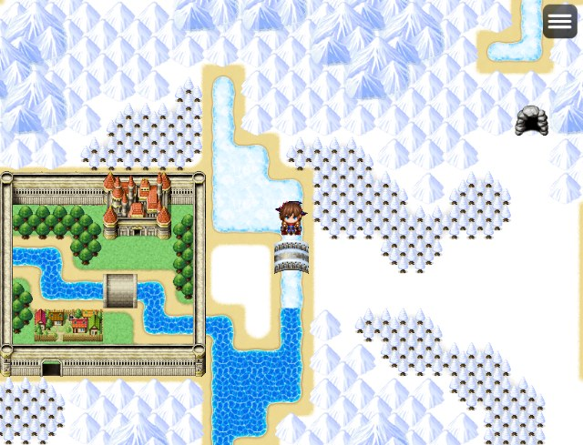
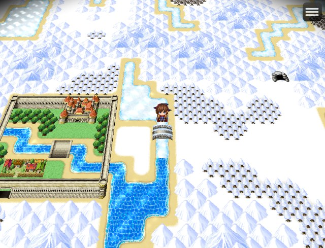
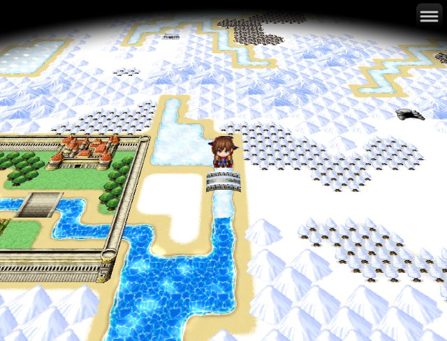
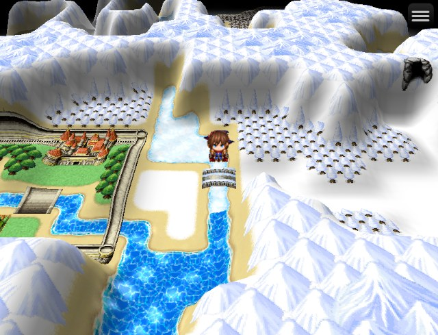
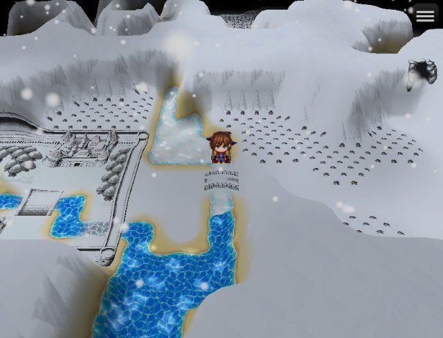
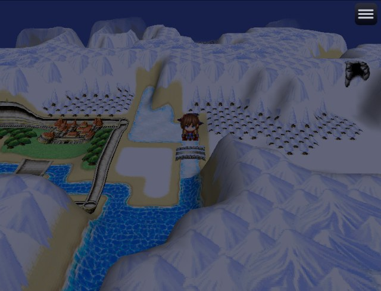

# Your First 3D Map

A walk from a flat map to a 3D one with hills, water, weather and day and night. It takes about ten minutes. The screenshots are RPG Maker MZ's sample "World" map with nothing added but the settings below.

Everything here is in the editor's map panel (press **F10** in a playtest, then look at the **Details** panel on the right with nothing picked). Each setting is one undo step, and the map changes as you go. Type a word into **Search settings** at the top of the panel to jump to a setting.

## 1. Start from a normal map

Any map works. Outdoor maps with water and a world tileset show off the most, so start with one of those.

## 2. Turn on the 3D view

Open **3D View (this map)** and tick **Show this map in 3D**.

The tiles now lie on a ground plane seen in perspective. Characters, their gear and standing doodads stand up as billboards. Nothing about the map itself changed: untick the box and it is flat again.

## 3. Set up the camera

In the same section:

- **Camera tilt**: lower it (about 35–45) to look across the land, raise it towards 89 to look straight down.
- **Zoom**: how big things are in the middle of the screen.
- **View distance**: how much ground is drawn. More costs more each frame; 30–40 tiles is plenty.
- **Fog starts / ends**: distant ground fades out. Keep **Fog ends** a little under half the view distance so the ground's edge never shows.

In the editor you can also look around with the mouse: middle-drag orbits, Shift + middle-drag pans, the wheel zooms, and a middle click goes back to the map's camera. That only changes your view while editing.

## 4. Raise the ground

Open **Terrain Height (this map)** and tick **Raise the ground**. On a world tileset, mountains and forests rise on their own (**Automatic**); set **Mountain height** to 2 for taller ranges. Choose **Smooth** for hills, **Stepped** for cliffs and plateaus.

To shape the land yourself, pick the **Hills** tool in the top bar: raise, lower, flatten, set or erase, with a radius. The tiles a stroke will change are shown on the ground before you paint. Each stroke is one undo step.

Tileset trees and objects (the B–E tiles) lie flat by default. To stand them up, set **Tileset objects** in the 3D View section to *Objects with ☆ tiles*, or place real doodads.

## 5. Water and weather

Back in **3D View**: **Rippling water** is on by default; raise **Ripple strength** and **Sparkle** for a livelier sea. Boats and anything wading leave wakes.

Weather comes from MZ's own **Set Weather Effect** event command: rain, storms and snow fall through the 3D world, splash on the ground and ripple the water. Tick **Snow settles** and snow gradually whitens the ground and the tops of trees. **Cloud shadows** and **Low fog** add drifting shadows and mist in valleys.

## 6. Day and night

Turn on the day/night clock in **Day and Night** (project-wide: a running clock, or variables). With **Sky, sun, moon and stars follow the time of day** ticked in 3D View, the sky fades from blue to an orange sunset to a starry night, the sun and moon cross it, and hills and water are lit from the sun's side. Use **Preview a time** in Day and Night to see any hour while editing.

## 7. Finishing touches

- **Minimap in the corner**, and the **Show World Map** plugin command (a globe on planet-shaped maps).
- **Battles show this map in 3D behind the fight.**
- **Round world**: *Planet* with a radius of 0 wraps a looping map into a small world.
- **Sky video**: a looping movie as the sky, either a 360° panorama that turns with the camera or one that fills the sky.
- **Models**: a doodad can show a glTF model (animated ones too) in its **3D Model** section.
- Players on slower machines can lower **Effects Quality** in Options: Medium and Low draw less ground, less weather and simpler hills.

Section 14 of the [User Guide](../Docs_Doodads_Guide.md#14-3d-view) describes every 3D setting, and the [Cheat Sheet](../CHEAT_SHEET.md) lists the plugin commands (Set Camera, Set 3D View and the rest) for cutscenes.
